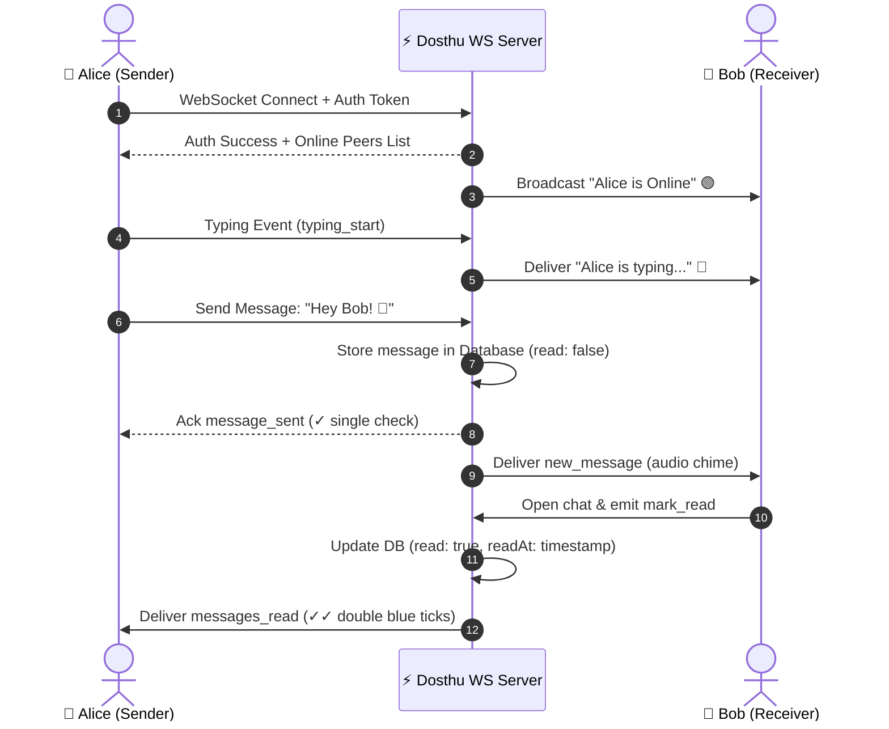

# 💬 Dosthu - Real-Time Chat Application

> **Course Project:** Full Stack Web Development (FSWD)  
> **Brand Name:** **Dosthu** (*"Where conversations come alive"*)  
> **Architecture:** Client-Server, Event-Driven Real-Time Architecture (WebSockets RFC-6455 & REST API)

---

## 🌟 Overview

**Dosthu** is a full-stack, real-time messaging web application engineered for high responsiveness, sleek aesthetics, and instant zero-refresh communication. It empowers users to securely register, authenticate, discover peers, track live online/offline presence, exchange messages instantaneously, observe real-time typing indicators, and inspect message delivery & read receipts (double checkmarks).

Designed specifically for an academic **Full Stack Web Development (FSWD)** course, Dosthu showcases mastery of modern client-server communication, database persistence, cryptographic authentication, and low-latency bidirectional socket protocols.

---

## 🎨 Visual Design & Aesthetics

- **Color Palette:** Deep Indigo (`#1e1b4b`), Electric Violet (`#6366f1`), Radiant Pink (`#ec4899`), Emerald Online Accent (`#10b981`), and Sleek Slate (`#090d16`).
- **Glassmorphism:** Modern frosted backdrop blur (`backdrop-filter: blur(20px)`), glowing border accents, and ambient radial background gradients.
- **Micro-Interactions & Animations:** Kinetic bounce typing indicators, message bubble pop-ins, status pulse rings, and modal spring transitions.
- **Theme Support:** One-click Dark Mode / Light Mode switcher with instantaneous state persistence.
- **Delightful UI Audio Effects:** Synthesized audio cues via Web Audio API (soft bubbly pop on message sent, pleasant dual-tone chime on message received) with a mute toggle.
- **Creative Vector Logo:** Custom dual interlocking speech bubbles forming a heart/infinity bond with modern geometric typography.

---

## 🚀 Key Features

| Feature | Description |
| :--- | :--- |
| **User Authentication** | Secure user registration and login with salt-based PBKDF2 password hashing and HMAC-SHA256 signed JWT tokens. |
| **Real-Time 1-to-1 Messaging** | Instant message exchange via low-latency WebSockets with zero page refresh. |
| **Live Presence Tracking** | Real-time broadcast of online/offline status and last seen timestamps. |
| **Typing Indicators** | Live animated 3-dot typing indicators notifying recipients when their friend is drafting a message. |
| **Read Receipts** | Automatic read receipt delivery: single checkmark `✓` when sent, double cyan checkmarks `✓✓` when read by recipient. |
| **Chat History & Timestamps** | Persistent storage with grouped date separators (*Today*, *Yesterday*, formatted dates) and message timestamps. |
| **Profile Management** | Change display name, customize bio/status, and select from custom vector memoji avatars. |
| **Quick Emoji Reactions** | Fast 1-click reaction bar (❤️, 🔥, 👍, 😂, 🎉, 🚀) and popover emoji palette. |
| **Responsive Mobile Layout** | Adaptive layout supporting fluid transitions on mobile phones, tablets, and wide monitors. |
| **1-Click Demo Logins** | Instant pre-configured demo account switcher for seamless classroom and viva presentations. |

---

## 🏗️ System Architecture

### High-Level Architecture Diagram

```mermaid
flowchart TD
    subgraph Client ["Client Browser (SPA)"]
        UI["Modern Glassmorphism UI (HTML5 / CSS3)"]
        State["App & Chat Manager (Vanilla JS)"]
        WSClient["WebSocket Protocol Client"]
        RestClient["Fetch REST API Client"]
        Audio["Web Audio Synth Engine"]
    end

    subgraph Server ["Node.js Application Server"]
        HTTP["HTTP Static & REST Server (port 3000)"]
        AuthRouter["/api/auth Router"]
        UserRouter["/api/users Router"]
        MsgRouter["/api/messages Router"]
        WSServer["RFC-6455 WebSocket Engine"]
        Presence["Active Socket & Presence Manager"]
    end

    subgraph Database ["Data Persistence Layer"]
        DBStore[("JSON / MongoDB Storage Engine<br>data/dosthu.json")]
    end

    UI --> State
    State --> WSClient
    State --> RestClient
    State --> Audio

    RestClient -->|HTTP POST / GET / PUT / DELETE| HTTP
    HTTP --> AuthRouter
    HTTP --> UserRouter
    HTTP --> MsgRouter

    WSClient <-->|Bidirectional WS Frames (ws://)| WSServer
    WSServer <--> Presence

    AuthRouter --> DBStore
    UserRouter --> DBStore
    MsgRouter --> DBStore
    WSServer --> DBStore
```

### Real-Time WebSocket Communication Sequence



---

## 📂 Project Structure

```
d:\FSWD-CBS-PROJECT\
├── package.json              # Project dependencies and npm scripts
├── .env.example              # Environment variables template
├── .gitignore                # Git ignore patterns
├── README.md                 # Complete project documentation
├── PROJECT_REPORT.md         # Academic report & Viva guide
├── test_units.js             # Automated unit test suite
├── data/
│   └── dosthu.json           # Persistent document database
├── src/
│   ├── server.js             # HTTP server and WebSocket entry point
│   ├── db/
│   │   └── database.js       # Database abstraction layer (CRUD, seed, atomic writes)
│   ├── routes/
│   │   ├── auth.js           # Authentication endpoints (Register, Login, Me, Logout)
│   │   ├── users.js          # User list and Profile updates
│   │   └── messages.js       # Message retrieval, sending, read marking, clear chat
│   ├── websocket/
│   │   └── wsServer.js       # Native RFC-6455 WebSocket protocol implementation
│   └── utils/
│       ├── authHelper.js     # PBKDF2 hashing, JWT signing and validation
│       └── mime.js           # Static MIME types resolution
└── public/
    ├── index.html            # Main single-page application structure
    ├── assets/
    │   ├── logo.svg          # Dosthu brand vector logo
    │   ├── logo-icon.svg     # App icon & favicon
    │   └── avatars/          # Preset SVG avatars (avatar-1 to avatar-6)
    ├── css/
    │   ├── style.css         # Glassmorphism, colors, CSS variables, utility classes
    │   ├── animations.css    # Keyframe animations (pulse, slide, pop, bounce)
    │   └── chat.css          # Chat layouts, bubbles, inputs, responsive rules
    └── js/
        ├── audio.js          # Synthesized Web Audio sound effects
        ├── emoji.js          # Emoji picker and quick reactions
        ├── socket.js         # WebSocket client manager
        ├── auth.js           # Authentication controller
        ├── profile.js        # Profile & avatar editor
        ├── chat.js           # Conversation manager and message stream
        └── app.js            # App orchestrator, shortcuts, theme toggle
```

---

## ⚡ Quick Start Guide

### 1. Prerequisites
- **Node.js** (v18.0.0 or higher recommended, tested on Node v24)
- Web browser (Chrome, Edge, Firefox, Safari)

### 2. Start the Application
Run the start command from the project root directory:

```bash
node src/server.js
```
*(Or if dependencies are installed, you can also run `npm start`)*

### 3. Open in Browser
Open your browser and navigate to:
```
http://localhost:3000
```

---

## 👥 Pre-Configured Demo Accounts (For Viva / Evaluation)

To test multi-user real-time chat instantly, open two different browser windows (e.g., standard window and an incognito window):

| Name | Username | Password | Bio |
| :--- | :--- | :--- | :--- |
| **Harish Kumar** | `harish` | `dosthu123` | Coding the future with Dosthu! 🚀 |
| **Ananya Sharma** | `ananya` | `dosthu123` | Designing clean UI/UX & aesthetic vibes ✨ |
| **Karthik Raja** | `karthik` | `dosthu123` | Full-stack enthusiast \| Building cool stuff 💻 |
| **Sneha Patel** | `sneha` | `dosthu123` | Coffee, Code & Curiosity ☕ |
| **Vikram Singh** | `vikram` | `dosthu123` | Always up for a quick tech chat! 🎯 |

> 💡 **Tip:** On the login screen, click any of the **Quick 1-Click Demo Login** pills (Harish, Ananya, etc.) to log in with a single click!

---

## 📡 REST API Reference

| Method | Endpoint | Description | Auth Required |
| :--- | :--- | :--- | :---: |
| `POST` | `/api/auth/register` | Register new user account | ❌ |
| `POST` | `/api/auth/login` | Authenticate user & issue JWT | ❌ |
| `GET` | `/api/auth/me` | Fetch currently logged in user info | ✅ |
| `POST` | `/api/auth/logout` | Invalidate current session | ✅ |
| `GET` | `/api/users` | Get user list with unread counts & status | ✅ |
| `PUT` | `/api/users/profile` | Update profile (name, bio, avatar) | ✅ |
| `GET` | `/api/users/:id` | Get specific user details | ✅ |
| `GET` | `/api/messages/:userId` | Get chat history with target user | ✅ |
| `POST` | `/api/messages` | Send message (REST fallback) | ✅ |
| `POST` | `/api/messages/:userId/read` | Mark conversation as read | ✅ |
| `DELETE` | `/api/messages/:userId` | Clear conversation history | ✅ |

---

## ⚡ WebSocket Events Reference

| Event Name | Direction | Payload | Description |
| :--- | :---: | :--- | :--- |
| `auth` | Client ➔ Server | `{ token }` | Authenticates socket connection with JWT. |
| `auth_success` | Server ➔ Client | `{ userId, onlineUsers }` | Confirms authentication & sends active peer IDs. |
| `send_message` | Client ➔ Server | `{ receiverId, text, type }` | Dispatches new real-time message. |
| `new_message` | Server ➔ Client | `{ id, senderId, text, createdAt }` | Delivers message instantly to recipient. |
| `message_sent` | Server ➔ Client | Message object | Confirms transmission to sender. |
| `typing_start` | Client ➔ Server | `{ receiverId }` | Triggers animated typing bubble on recipient screen. |
| `typing_stop` | Client ➔ Server | `{ receiverId }` | Hides animated typing bubble on recipient screen. |
| `mark_read` | Client ➔ Server | `{ senderId }` | Marks messages as read. |
| `messages_read` | Server ➔ Client | `{ readBy, readAt }` | Turns checkmarks into blue double ticks (`✓✓`). |
| `user_status` | Server ➔ Client | `{ userId, status, lastSeen }` | Broadcasts online/offline status updates. |
| `profile_update` | Client ➔ Server | Updated user profile | Broadcasts name/avatar/bio modifications. |

---

## 🧪 Automated Testing

To run the unit test suite verifying database operations, password encryption, JWT tokens, and message delivery:

```bash
node test_units.js
```

---

## 📄 License
This project is developed as an academic submission for the Full Stack Web Development (FSWD) curriculum. Distributed under the MIT License.
